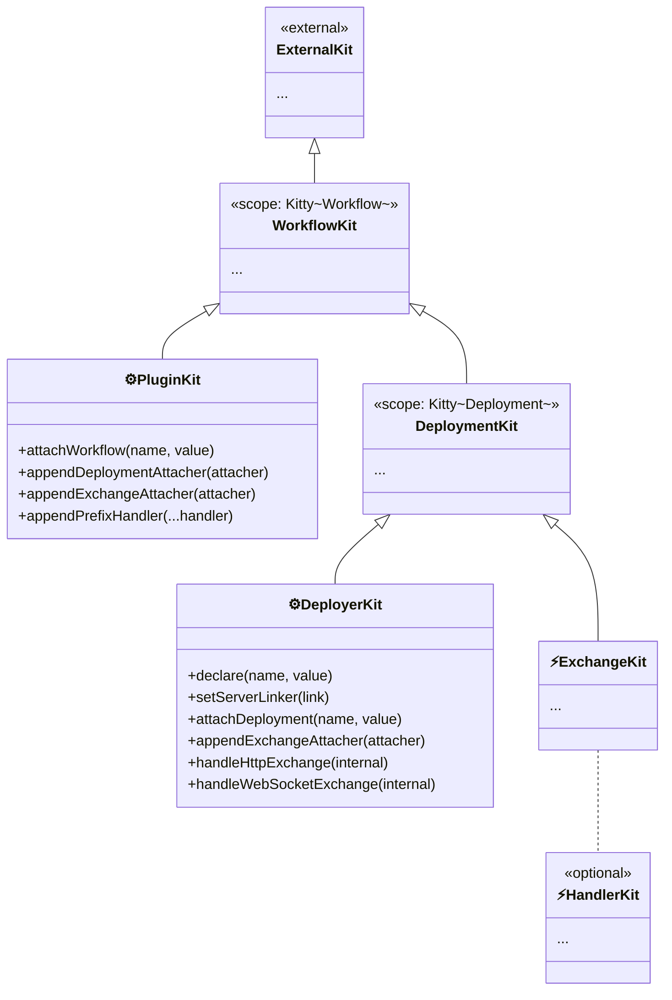

# KittyWorkflow Design

## Document Scope

`DESIGN.md` is the single design document for `packages/workflow`
(`@produck/kitty-workflow`). It records the philosophy, the settled
contracts, and the questions that are still open. It is a near-final
draft: a settled statement changes only by a deliberate decision, not by
drift while an extension or integration package is being built.

`src/` is the behavioural source of truth. When this document and the
code disagree, the code is right and this document is a defect.

## Terminology

**Attachment** — at kit level, the act of appending a dependency or
capability to a `Kit`, which acts as the domain tracker for that part of
the assembled program.

In KittyWorkflow, attachment is narrowed into a controlled structural
write. An attachment may install a workflow-static dependency, register
a deployment attacher, or register an exchange attacher. The derived
term **attacher** means a function recorded by one domain and later run
to attach dependencies into another kit scope.

The important property in workflow assembly is control. Attachment is
not arbitrary mutation of the kit; it is a lifecycle-guarded structural
write performed through an authorized surface. **PluginKit** and
**DeployerKit** are attachment ports: supplier-facing facades that
expose specific attachment abilities without exposing the workflow
authority behind them.

| Term     | Meaning                                                                 |
| -------- | ----------------------------------------------------------------------- |
| subject  | One directory under `src/` holding one class and its own symbols.       |
| part     | A member of the `ExchangePart` family: Request, Response, Header, Body. |
| slot     | A `_S` symbol whose value is a class reference supplied downstream.     |
| internal | The connection-time record a deployer passes to the dispatch.           |
| identity | One native object per logical exchange, used to reject double dispatch. |
| manifest | A deployer-declared record of named materials for the compile path.     |
| link     | A plain function `(…)` that wires a compiled deployment to a server.    |
| compile  | Build a deployment from a workflow and a server; do not link.           |
| deploy   | Compile, then link.                                                     |
| tune     | Adjust a supplier-owned runtime parameter on a workflow.                |
| attach   | Install a capability or register an attacher.                           |
| fork     | Take a fresh, from-byte-0 copy out of a `Distributor`.                  |

## Philosophy

Kitty shares a core design with Koa — middleware pipeline orchestration —
but targets more complex layering and division of labour.

In Koa, every new capability is abstracted as middleware, yet some
high-frequency features remain hardcoded (response body detection,
content negotiation). These work well for common scenarios, but become
constraining when the pipeline needs to diverge — WebSocket passthrough,
custom upload handling, protocol-specific optimisation. There is no clean
way to strip unwanted built-in behaviour.

Kitty treats features as **composable building blocks**: capabilities are
added to the pipeline in an orderly, predictable, observable way. Nothing
is hardcoded — every feature must be explicitly composed, and every layer
has a well-defined boundary (Kit → Workflow → Deployment → Exchange).
This keeps the core simple and the extension path clear.

`@produck/kitty-workflow` is the central design object for orchestrating
server handlers under this philosophy.

## Kit As Scope Inheritance

`@produck/kit` is best understood here as a scope-inheritance mechanism
for program assembly. It models capability distribution as inheritance
between explicit runtime scopes, rather than as parameter passing, global
registries, or call-frame context.

The tracked unit is a structural scope, not a call frame. A frame may be
where a child kit is physically created, but the design intent is to
express where a capability belongs in the assembled program:

```text
WorkflowKit -> DeploymentKit -> ExchangeKit -> Handler child kits
```

This keeps the main composition question small: which scope should own
this capability? Once installed at the right scope, the capability is
distributed downward by normal kit inheritance and is readable with
ordinary property syntax.

`WorkflowKit` also carries the workflow instance itself as a stable
identity capability (`K_WORKFLOW`). Downstream code reads it through
`useWorkflow(kit)` and may use it as a `WeakMap` key, but never receives
write access to `WorkflowKit`. Structural writes stay behind guarded
attachment-port methods.

Kitty is a concrete use of this mechanism. It does not try to model all
program effects as typed computations. It uses kit inheritance to
assemble workflow, deployment, deployer, exchange, and handler
capabilities at the layers where they belong.

## Core As Authority Boundary

> Kitty core is "dividing territory and assigning authority".

The core does not own downstream feature grammar, but it does own the
authority model: which runtime scopes exist, which attachment ports are
issued, which structural writes are allowed, and when those writes
expire.

In engineering terms, core is responsible for:

- dividing the kit hierarchy into workflow, deployment, deployer,
  exchange, and handler scopes;
- owning the workflow assembly surface and granting attachment ports
  such as `PluginKit` and `DeployerKit` as facades to that surface;
- keeping structural writes behind guarded methods;
- defining lifecycle windows such as finalization, deployment artifact
  construction, and per-exchange runtime scope;
- exposing workflow identity without exposing the writable
  `WorkflowKit` surface.

Downstream suppliers own feature grammar and runtime policy. Handler
authors consume inherited capabilities. Core's job is to keep those roles
from accidentally receiving each other's authority.

### Workflow Assembly Surface

The stable source of structural attachment authority is the workflow
assembly surface. It is owned by `WorkflowKit`, not independently by each
supplier-facing kit.

The assembly surface consists of three controlled capability classes,
distributed across the supplier-facing kits that own each attachment
phase:

- **Workflow-static dependencies**: attached via
  `attachWorkflow(name, value)`. Written to `WorkflowKit`, inherited by
  all downstream kits. Exposed through `PluginKit`.
- **Deployment attachers**: functions recorded during the installation
  phase and run during compile-time `DeploymentKit` preparation. Exposed
  through `PluginKit` only — `DeployerKit` writes `DeploymentKit`
  directly via `attachDeployment(name, value)`.
- **Exchange attachers**: functions recorded during the installation or
  compile phase and run when an `ExchangeKit` is prepared. Exposed
  through both `PluginKit` and `DeployerKit`, each with its own lifecycle
  window.

`PluginKit` and `DeployerKit` are supplier-facing facades over subsets of
the workflow assembly surface. Each port exposes only the abilities
relevant to its role and lifecycle phase. After `finalize()`, structural
additions to the assembly surface are closed.

## Architecture Layering

`KittyWorkflow` is split into two layers.

- **Abstract layer** (`Workflow/`): the lifecycle template —
  `constructor(ExternalKit)` → `use(handler)` → `finalize()` →
  `compile(server)` / `deploy(server)`. It exposes extension hooks
  (`_I.COMPOSE.EXTEND`, `_I.COMPILE_DEPLOYMENT`) for subclasses to fill,
  and installs the `useWorkflow` identity capability on `WorkflowKit`.
  It knows nothing about plugins, the deployer registry, or one-time
  deployers — it is a purely extensible skeleton. It does not install
  configuration and does not recognise `Configuration`.

- **Composition layer** (`CompoundWorkflow/`): extends the abstract layer
  and implements two orthogonal domains — **Plugin** and **Deployer** —
  each responsible for a distinct kind of capability injection. It owns
  `mixin()`, `withDeployer()`, and the default configuration record.

Extension hooks:

| Hook                    | Implemented by    | Called at                                        |
| ----------------------- | ----------------- | ------------------------------------------------ |
| `_I.COMPOSE.EXTEND`     | Composition layer | `finalize()` — prepends prefix handlers          |
| `_I.COMPILE_DEPLOYMENT` | Composition layer | `compile()` / `deploy()` — builds the deployment |

## Lifecycle

### Abstract layer

```text
constructor(kit) -> use(handler)* -> finalize()
  -> compile(server) / deploy(server)
  -> (request) -> ExchangeKit
```

- **Construction**: accepts a kit (default `Kit.global`), derives
  `WorkflowKit` via `ExternalKit('Kitty<Workflow>')`, stores the
  workflow identity on `WorkflowKit`.
- **Orchestration**: `use(handler)` appends handlers to the handler
  list and returns `this`. Handlers must be functions with arity ≤ 2.
- **Finalization**: `finalize()` freezes the handler list, prepends it
  to the pipeline through `Composer.compose`, runs the composition
  extension, then freezes the instance. After that, `use()` and
  `mixin()` are rejected.
- **Compile**: `compile(server)` builds a `Deployment` and returns it
  without linking; `deployment.manifest` holds declared materials.
- **Deploy**: `deploy(server)` builds the deployment, then calls
  `deployment.link()` to wire the server through the composed linker
  chain.

### Composition layer

```text
constructor(kit) -> mixin(PluginClass)* -> use(handler)* -> finalize()
  -> deploy(server) / compile(server) / withDeployer(DeployerClass)
  -> Deployer.Registry lookup -> DeploymentKit prepared
  -> deployer[$I.INSTALL]() -> exchange attachers registered
  -> deployment[$I.COMMIT]() -> link() -> server wired
  -> (request) -> ExchangeKit -> Exchange constructed -> pipeline
```

The composition layer also owns deployment-scoped workflow state: the
request body distributor class. `deploy()` refuses to run while that
class is unset; `compile()` is not gated.

## Kit Hierarchy



This diagram is also an authority boundary. Handler code travels through
the `ExchangeKit` branch and does not naturally receive `PluginKit` or
`DeployerKit`. Those kits are attachment ports managed by their
suppliers. If a supplier wants handler code to adjust a feature, it
exports an adjustment function that accepts workflow identity. Handler
code reads that identity with `useWorkflow(ExchangeKit)` and calls the
supplier API; no kit-visible adjuster path is needed.

The full hierarchy is a core-level view, not a required mental model for
every downstream role. Handler authors normally see only their current
kit and supplier-provided `use*()` functions. Plugin suppliers work with
`PluginKit` and guarded writes toward `WorkflowKit`. Deployer suppliers
work with `DeployerKit`, `DeploymentKit`, and `ExchangeKit` because they
own the protocol bridge.

### Kittable Items

| Kit             | Derived from                       | Lifetime              |
| --------------- | ---------------------------------- | --------------------- |
| `ExternalKit`   | caller (default `Kit.global`)      | application           |
| `WorkflowKit`   | `ExternalKit('Kitty<Workflow>')`   | one per workflow      |
| `PluginKit`     | `WorkflowKit('Kitty<Plugin>')`     | one per `mixin()`     |
| `DeploymentKit` | `WorkflowKit('Kitty<Deployment>')` | one per compile       |
| `DeployerKit`   | `DeploymentKit('Kitty<Deployer>')` | one per deployment    |
| `ExchangeKit`   | `DeploymentKit('Kitty<Exchange>')` | one per exchange      |
| `HandlerKit`    | handler's own discretion           | optional, per handler |

- A one-time deployment (`withDeployer()`) names its kit
  `Kitty<Deployment:OneTime>`.
- `ExchangeKit` and `HandlerKit` are created **per request**; the parent
  kits are created once at setup.
- `HandlerKit` may not exist at all — a handler that neither derives a
  child kit nor passes one to `next()` simply never creates that layer.

### Capability getters

The package exports strict getters, each wrapping one symbol key:

| Getter         | Key                   | Answers                      |
| -------------- | --------------------- | ---------------------------- |
| `useWorkflow`  | `K_WORKFLOW`          | the workflow instance        |
| `useServer`    | `K_DEPLOYMENT_SERVER` | the server of the deployment |
| `useExchange`  | `K_EXCHANGE`          | the current `Exchange`       |
| `useRequest`   | `K_REQUEST`           | the current request part     |
| `useResponse`  | `K_RESPONSE`          | the current response part    |
| `useWebSocket` | `K_CONTROLLER`        | the WebSocket controller     |

## Plugin Domain

A plugin is a **class**, not a plain installer function: it may hold
instance-level context for as long as the workflow lives. The workflow
entry point is still named `mixin()`.

`mixin(PluginClass)` validates that the argument is a `Plugin`
subclass, constructs it with `(WorkflowKit, workflow)`, and immediately
runs `$I.INSTALL()` against its own `PluginKit`. There is no deferral
queue, and no single-install enforcement — duplicate detection is the
plugin's own decision.

### PluginKit API

`PluginKit` is derived via `WorkflowKit('Kitty<Plugin>')`, one kit per
`mixin()` call. All methods target the workflow the plugin belongs to and
guard against post-finalization calls.

| Method                                      | Behavior                                                    |
| ------------------------------------------- | ----------------------------------------------------------- |
| `pluginKit.attachWorkflow(name, value)`     | Writes onto `WorkflowKit`; inherited by all downstream kits |
| `pluginKit.appendDeploymentAttacher(fn)`    | Runs `fn(DeploymentKit)` at compile time                    |
| `pluginKit.appendExchangeAttacher(fn)`      | Runs `fn(ExchangeKit)` for every exchange                   |
| `pluginKit.appendPrefixHandler(...handler)` | Prepends handler(s) to the pipeline at `finalize()`         |

`_I.INSTALL(PluginKit)` and `_S.TAG` are the plugin contract.

### Execution order at deploy

```text
1. Create the Deployment, deriving DeploymentKit from WorkflowKit
2. Plugin deployment attachers run on DeploymentKit, in registration order
3. Look up the deployer (registry, or the one-time association)
4. Derive DeployerKit from DeploymentKit; construct the deployer with
   (DeployerKit, deployment)
5. deployer[$I.INSTALL](DeployerKit) — declares manifest entries,
   linkers, exchange attachers and deployment content
6. Plugin exchange attachers are appended to the deployment
7. deployment[$I.COMMIT]() — the definition surface closes
8. deployment.link() — the linker chain runs (deploy only)
```

### Runtime exchange attacher execution order

```text
1. Identity resolved from the exchange class, deduplicated
2. Exchange constructed — it derives ExchangeKit itself
3. ExchangeKit carries K_EXCHANGE, K_REQUEST, K_RESPONSE
4. Exchange attachers run in registration order:
   deployer attachers first, then plugin attachers
5. Workflow handler pipeline runs
6. Lifecycle events: done | error, then finish
```

### Relationship with `use()`

`use(handler)` adds handlers to the **main handler sequence**.
`pluginKit.appendPrefixHandler(handler)` adds to the **prefix handler
sequence**. Both are composed at `finalize()` — prefix first, then main.

`PluginKit` does not offer a `use()` shortcut: plugin-supplied handlers
belong outside the business pipeline, and restricting the port to
`appendPrefixHandler` makes the wrapping order explicit.

## Deployer Domain

The deployer domain is responsible for **server-type-specific protocol
bridging** — translating raw events of a particular server
implementation into the uniform `Exchange` abstraction.

**The definition surface is a class, not an options record**, and it is
instance-level: a deployer may hold context with the same lifetime as
the workflow instance.

### Deployer registration

A deployer is registered once per server constructor through
`DeployerRegistry.registerDeployer(DeployerClass)`.

| Member                        | Level              | Meaning                                                |
| ----------------------------- | ------------------ | ------------------------------------------------------ |
| `_S.TAG`                      | static, abstract   | Logical deployer tag                                   |
| `_S.SERVER_CTOR`              | static, abstract   | Targeted `net.Server` subclass; also the registry key  |
| `_S.EXCHANGE_CTOR.HTTP`       | static, abstract   | HTTP exchange class; required                          |
| `_S.EXCHANGE_CTOR.WEB_SOCKET` | static, abstract   | WebSocket exchange class, or `undefined`; optional     |
| `_I.INSTALL(DeployerKit)`     | instance, abstract | The single entry point where deployment behavior lives |

Both exchange slots stay declared, so both keep their type: a value that
is not a derivation of the expected `Exchange` is rejected on read. They
differ in whether absence is legal. The base answers `undefined` for the
WebSocket slot and the member parser accepts it, so a deployer that
serves no WebSocket is valid; `handleWebSocketExchange` reports that
absence as a deployer error. The HTTP slot has no such default, so the
abstract layer itself answers for its absence.

Because `Deployer.Abstract` declares static members, every derivation
must be wrapped in `SubConstructorProxy`. The base constructor receives
`(DeployerKit, deployment)`; `SYMBOL.CONSTRUCTOR = new.target` is the
only way to read the static slots.

### Lookup

Deployer resolution is two-level:

1. **Instance level**: a class explicitly associated with one server
   instance. `withDeployer()` sets this.
2. **Constructor level**: the class registered for the server's
   constructor.

`getByServer(server)` checks the instance map first, then
`Object.getPrototypeOf(server).constructor` in the registry.

- **Framework-level distribution**: library authors register deployers
  for standard server constructors; `deploy(server)` then finds the
  right one.
- **Per-instance override**: `withDeployer()` binds one deployer to one
  server instance, bypassing registration.

The registry stores the **class only**, keyed by
`DeployerClass[_S.SERVER_CTOR]`. `registerDeployer` asserts only that
the class is a `Deployer` subclass; the static slots validate themselves
on read. The deployment instance is created later, during
`_I.COMPILE_DEPLOYMENT`, once a `DeployerKit` exists. Without the
explicit `SubConstructorOf(Deployer)` assertion, a plain class would
register silently as `undefined`.

### DeployerKit API

`DeployerKit` is derived via `DeploymentKit('Kitty<Deployer>')` and is
the deployer's whole capability surface. A deployer cannot mutate
`DeploymentKit` directly.

| Method                                          | Behavior                                                     |
| ----------------------------------------------- | ------------------------------------------------------------ |
| `deployerKit.declare(name, value)`              | Declares a named manifest entry for the compile path         |
| `deployerKit.setServerLinker(link)`             | Pushes a linker onto a LIFO stack                            |
| `deployerKit.attachDeployment(name, value)`     | Attaches a value onto `DeploymentKit` for downstream use     |
| `deployerKit.appendExchangeAttacher(fn)`        | Registers an attacher for every `ExchangeKit`                |
| `deployerKit.handleHttpExchange(internal)`      | Dispatches using `[_S.EXCHANGE_CTOR.HTTP]` + `internal`      |
| `deployerKit.handleWebSocketExchange(internal)` | Same with the WebSocket slot; throws when the slot is absent |

All methods guard against post-commit calls through the deployment's
single `COMMITTED` flag. The deployer keeps no install marker of its
own, so there is no "installed but not committed" intermediate state.

### Deployment fill and artifact split

The deployer **writes into the deployment** and keeps no artifact state
itself. Everything the deployment later exposes comes through the
deployer:

| Deployment state   | Written by               | Read by              |
| ------------------ | ------------------------ | -------------------- |
| manifest           | `declare`                | `get manifest`       |
| linker list        | `setServerLinker`        | `link()`             |
| exchange attachers | `appendExchangeAttacher` | `$I.ATTACH_EXCHANGE` |
| deployment kit     | `attachDeployment`       | downstream consumers |

`manifest` entries are named materials with unconstrained values;
`link` functions are plain `(…) => unknown` attachments. The compile path
consumes the manifest; the deploy path additionally runs the linkers.

### Protocol resources on ExchangeKit

The deployer owns the `stream` / `request` event and is responsible for
creating the `internal` record and calling the dispatch.

> **Open**: protocol-specific resources (`stream`, `session`, trailers,
> push, reset) can no longer be installed onto `ExchangeKit` from the
> deployer's listener, because the dispatch derives that kit. They must
> either travel inside the `internal` record (readable only by the
> deployer's own Exchange and parts) or be installed by an exchange
> attacher that runs before the handler pipeline. Which route is
> intended is not settled.

These resources are **deployer-specific** and not part of the core
Exchange Template. They follow the same "not installed, not available"
contract as any other kit capability.

## Deployer/Workflow Bridge Protocol

The dispatch — `[I.HANDLE_EXCHANGE]` on the deployment — is the sole
bridge between the deployer layer (protocol-specific) and the workflow
layer (application logic, server-agnostic).

### Contract

The deployer receives a `DeployerKit`. It must:

1. Declare protocol-specific entry points through `declare` and wire the
   server through `setServerLinker`.
2. On each incoming exchange, build the per-exchange `internal` record
   its own Exchange class needs and call `handleHttpExchange(internal)`
   or `handleWebSocketExchange(internal)`.

The **kit entry** picks the exchange class from the deployer class and
hands it to the dispatch with `internal`. The **dispatch** reads the
identity, rejects a repeat, constructs the Exchange (which derives the
`ExchangeKit`), runs the exchange attachers, then executes the composed
pipeline.

### Protocol invariant

- The deployer does not know what handlers were registered via `use()`
  or which plugins are installed. It interacts only with
  `DeploymentKit` and the dispatch entries.
- The workflow does not know the server type, event model, or transport
  protocol. It interacts only with capabilities installed on its kit.
- Protocol selection happens **before** construction: the two exchange
  families share no `internal` shape, and `mode` only exists after
  construction. Splitting by protocol turns the pairing into a named
  fact written on the port instead of a runtime guess.

### Deployment flow

```text
deploy(server) / withDeployer(DeployerClass).deploy(server)
  │
  ├─ 1. Create the Deployment (DeploymentKit + server + workflow)
  ├─ 2. Run plugin deployment attachers on DeploymentKit
  ├─ 3. Look up the deployer (registry or instance association)
  ├─ 4. Derive DeployerKit; construct the deployer
  ├─ 5. deployer[$I.INSTALL](DeployerKit)
  ├─ 6. Append plugin exchange attachers to the deployment
  ├─ 7. deployment[$I.COMMIT]() — the definition surface closes
  └─ 8. deployment.link() — the linker chain runs (deploy only)
```

`compile()` stops after step 7 and returns the deployment; its `manifest`
carries the declared materials. `deploy()` continues through step 8.

### Dispatch guardrails

The dispatch must reject bad deployer input before any handler runs.

- The deployer must be registered with an `Exchange` class per protocol;
  that pairing is checked at registration time with
  `SubConstructorOf(HttpExchange.Abstract)` (and the WebSocket
  equivalent).
- `internal` is passed straight to the Exchange constructor and stored
  by the Exchange; the core never inspects its shape.
- The Exchange is constructed **here**, from the registered class and the
  `DeploymentKit` — not installed by the deployer beforehand — and the
  `ExchangeKit` it derives carries `K_EXCHANGE`, `K_REQUEST`,
  `K_RESPONSE`. `useExchange` / `useRequest` / `useResponse` are their
  readers.
- A repeated identity is rejected before any object graph is built: no
  half-constructed exchange, no stray timer.
- Dispatch failures are deployer errors, not handler errors. `.use()`
  handlers may assume a validated `ExchangeKit` once the pipeline starts.
- The deployer's listener still decides whether an event produces an
  exchange at all; the dispatch owns construction, installation, and the
  guards.

### Exchange identity and duplicate consumption

Identity is resolved **before** the exchange is constructed:
`TargetExchange[$S.IDENTITY](internal)` forwards to the abstract static
slot every concrete Exchange must implement. The dispatch records the
result in the deployment's `WeakSet`.

The model layer exposes identity; the bridge layer owns consumption. That
is not two guards but two responsibilities — the model answers, the
bridge decides. The exchange instance never answers identity, so it keeps
only the protected `$I.INTERNAL` record getter that its parts read.

A duplicate is reported as a neutral error
(`The Exchange has already been dispatched.`) with no
`[DeployerImplementationError]` prefix: the deployment cannot import the
deployer error helper without creating a cycle, and attribution is the
price of that rule.

### Motivation: server event models differ

| Server type    | Key events                            |
| -------------- | ------------------------------------- |
| `http.Server`  | `request`, `upgrade`, `checkContinue` |
| `http2.Server` | `session`, `stream`, `goaway`         |
| `net.Server`   | `connection`, `close`                 |

A unified lifecycle object at workflow level would either abstract these
into a lowest common denominator (losing type-specific capability) or
leak server-type knowledge into the workflow. The bridge protocol avoids
both by keeping the deployer the sole owner of protocol semantics.

## Exchange Template

### The three families

The exchange family has three layers, each answering only its own layer:

- **`Exchange`** (shell, `Workflow/Exchange/`): protocol-common facts —
  `identity`, `server`, `protocol`, `mode`, `httpVersion`, `workflow`,
  plus `request` and `response`. Abstract members: `_I.HTTP_VERSION`,
  `_I.MODE`, `_I.SERVER.GET`, `_I.SERVER.PROTOCOL.GET`; static slots
  `_S.IDENTITY`, `_S.REQUEST_CTOR`, `_S.RESPONSE_CTOR`.
- **`HttpExchange`** (protocol family, `CompoundWorkflow/HttpExchange/`):
  adds the two body parts and the timeout arming; `_I.MODE` answers
  `'http'`.
- **`WebSocketExchange`** (`CompoundWorkflow/WebSocketExchange/`): the
  **whole connection**, not the handshake moment; its main subject is the
  controller. `_I.MODE` answers `'websocket'`; `_S.CONTROLLER_CTOR` is
  its static slot.

Directions follow the dispatcher: the shell's deployment reads identity,
the protocol families read the compound workflow's state. The shell does
not recognise workflow types — `workflow` goes through the deployment.

Abstract members are pushed down to the owning part; `Exchange` is not a
member bus. `Part` is a **concrete** base class. The `internal` record
is the deployer-supplied connection-time record; it is passed as the
first argument of every `_I` member and is never put on the kit.

Freezing happens at each concrete implementation point, at the end of its
constructor; base classes never freeze themselves.

### Public API

```text
exchange.request         → ExchangeRequest       (readonly)
exchange.response        → ExchangeResponse      (readonly)
exchange.workflow        → Workflow              (readonly)
exchange.method          → string                (readonly, shortcut)
exchange.url             → URL                   (readonly, shortcut)
exchange.statusCode      → number                (readonly, shortcut)
exchange.statusText      → string                (readonly, shortcut)
exchange.setStatus(code[, text]) → void          (write)
exchange.server          → net.Server            (readonly)
exchange.protocol        → 'http:' | 'https:'    (readonly)
exchange.mode            → 'http' | 'websocket'  (readonly)
exchange.httpVersion     → string                (readonly)
exchange.toJSON()        → always throws         (exchange is not data)
```

`WebSocketExchange` adds `controller → WebSocketController`.
`HttpExchange` adds the body parts through its request and response.

### Member ownership

Primitive members live on the object with the highest conceptual
relevance. The exchange exposes unambiguous high-frequency shortcuts;
ambiguous names must be reached through `request.*` / `response.*`.

```text
Exchange-owned concepts
├── server, protocol, mode, httpVersion, workflow

Request concepts     → ExchangeRequest
├── method, url, header, body.data

Response concepts    → ExchangeResponse
├── statusCode, statusText, header, body.data, setStatus, isFinished
```

### Part families

| Part                      | Owner         | Public members                                      |
| ------------------------- | ------------- | --------------------------------------------------- |
| `ExchangeRequest`         | shell         | `header`, `method`, `url`                           |
| `ExchangeRequestHeader`   | request       | `get`, `has`, `keys`, `entries`                     |
| `ExchangeResponse`        | shell         | `header`, `statusCode`, `statusText`, `isFinished`  |
| `ExchangeResponseHeader`  | response      | `get`, `has`, `keys`, `entries`                     |
| `ExchangeMutableResponse` | shell         | `setStatus(code[, text])`                           |
| `ExchangeMutableHeader`   | response      | `set`, `delete`, `clear`                            |
| `HttpRequestBody`         | http exchange | `data` (stream), `distributor`                      |
| `HttpResponseBody`        | http exchange | `data` (sink record)                                |
| `WebSocketController`     | ws exchange   | `readyState`, `send(data)`, `close([code, reason])` |
| `WebSocketResponse`       | ws exchange   | `isFinished` is always `true`                       |

Mutable parts extend their read-only counterpart, so a deployer that has
no write path can hand out the read-only type. A header write is
validated strictly (name and value parsers), while a header read answers
`HeaderValueOrUndefined` — read loose, write tight.

### Defense layers

1. **Abstract proxy**: parsers validate types at construction and at
   every `_I` read (`P.HTTPStatusCode`, `P.HttpMethod`, …).
2. **Deployer error domain**: failures raised on the implementation side
   go through `ThrowDeployer(message, options)`, which prefixes
   `[DeployerImplementationError]` and forwards `{ cause }`.
3. **Public method self-check**: runtime assertions on method arguments
   independent of the abstract proxy (`Assert.HeaderName`,
   `Assert.HeaderValue`, `Assert.HTTPStatusCode`).

### Exchange factory

`Implement.Exchange.Http(options)` and `Implement.Exchange.WebSocket(
options)` build a whole set at once — the exchange plus every part — from
one normalised options record. They are packaging entry points, not
subjects: one call hands over a coherent family, and splitting it into
subjects would break the "delivered as a set" property.

### Events

The exchange is an `EventTarget`. Events carry **decisions and
lifecycle**, never data: data belongs to streams, and re-emitting it over
an event opens a second IO channel with a second set of backpressure
semantics.

Each event must answer: who dispatches, when, with what payload, in what
order, how many times.

| Event                          | Dispatched by        | Payload                           |
| ------------------------------ | -------------------- | --------------------------------- |
| `exchange-pipeline-done`       | dispatch, on success | none                              |
| `exchange-pipeline-error`      | dispatch, on failure | `detail.error`                    |
| `exchange-pipeline-finish`     | dispatch `finally`   | none                              |
| `http-exchange-timeout`        | `HttpExchange` timer | `detail.timeout`                  |
| `http-request-body-data-end`   | request body         | none                              |
| `http-request-body-data-close` | request body         | none                              |
| `http-request-body-data-error` | request body         | `detail.error`                    |
| `http-request-body-data-limit` | request body         | `detail.limit`, `detail.consumed` |
| `close` (controller)           | WebSocket controller | `code`, `reason`                  |

Ordering rule: exactly one of `done` / `error` is dispatched first, then
`error` is rethrown unchanged, and `finish` is always last, exactly once,
from a `finally` block. Deleting `finish` would push the cleanup duty onto
every deployer and would leak the `HttpExchange` timeout timer.

Only forward an event when downstream cannot reach the original object.
`distributor` is exposed as-is, so fugue events are not re-emitted. The
node `Readable` is wrapped by `Readable.toWeb()` and becomes
unreachable, so the body forwards its `end`, `close`, `error`, `limit`
events.

**Listener exceptions are not shielded.** Node rethrows a listener error
on `nextTick` as `uncaughtException`, at which point process state is
undefined. The library installs no global handler and wraps no
`dispatchEvent` in `try/catch`; the process manager restarts.

## Request, Response and Body

### Request URL

An absolute URL is used as-is. A relative one is resolved against
`exchange.protocol` plus the `host` header; a missing host raises a
deployer error, because RFC 7230 requires it for HTTP/1.1 origin-form
requests.

### Request body: a source

```text
node Readable
  → Readable.toWeb()
  → Distributor (deployment-scoped class)
  → data: a fresh WHATWG ReadableStream per access
```

- `data` answers a **fork**: a fresh copy from byte 0 on every access.
- `distributor` is exposed unchanged, so a handler may tune per-exchange
  differences itself. The framework offers no second configuration entry
  point and tracks no changes.
- Body size is accumulated from the distributor's `metric` events
  (`source-consumed-byte-length`). Over `MaxBodySize`, the body
  dispatches `limit`, destroys the distributor, and sets `413` when the
  response is still open.
- The distributor class is deployment-scoped workflow state, set with
  `setRequestBodyDistributorConstructor(Ctor)` and validated as a
  `Fugue.Distributor` derivation. It may be replaced at any time,
  including after `finalize()`.
- The 12 fugue options are proxied as `Configuration` items (PascalCase)
  and applied once, when the body builds its distributor. They express
  the layer's **baseline expectation** of downstream, not a "freely
  overridable default".
- The degraded-chunk reader is **not shipped here**: the integration layer
  supplies it through the distributor's static slot.
- Stream teardown prefers `terminate()` (synchronous, closes the gate
  only) over `destroy()` (errors already-issued copies and cancels the
  source).

### Response body: a sink

The handler hands a value to `response.body.data`; the deployer writes it
out. This package normalises that value into one record shape:

```js
{
  stream: ReadableStream | null, // null = no body
  length: number | null,         // known byte count, or unknown
}
```

`length` is always present and explicit. A string or a byte array has a
known length; a stream does not. `null` means exactly "unknown", and
nothing is inferred from it. The two sides agree: a `null` stream means no
body, so its length is exactly `0`, never `null`.

Responsibility split:

- **This package**: the record shape, the normalisation call at the
  setter, and the guard that the setter is still open.
- **The implementer**: the normalisation function itself. It is an
  abstract member (`_I.NORMALIZE_HTTP_RESPONSE_BODY_DATA`), so
  `CompoundWorkflow` cannot be used until it is supplied;
  `Implement.Workflow({ normalizeHttpResponseBodyData })` is the factory
  form.
- **The integration package**: the default preset set (string,
  `Uint8Array`/`Buffer`, `ReadableStream`, node `Readable`, no body) and
  any downstream additions such as JSON. Presets are a declared set, not
  a probe: nothing asks the value what it is.
- **The deployer**: everything protocol-specific, including
  `Content-Length` versus `Transfer-Encoding`, and the h1/h2 difference —
  HTTP/1.1 may chunk, HTTP/2 has no `Transfer-Encoding` at all. The
  framework sets neither header; it only states what is known.

`get data` answers a copy of the record: the body keeps it in a private
slot, so reading never calls back into the deployer, and a body nobody set
reads the no-body record `{ stream: null, length: 0 }`. The setter picks
the two contract fields, so extra fields from a normaliser never reach the
body nor the deployer.

### Finished guards and timeout

Once `response.isFinished` is true, further `setStatus()` and
`response.body.data = …` writes are rejected at the write site of each
part; implementation-side failures surface through `ThrowDeployer`.

Handler timeout is configured with
`Tune.MaxExchangeTimeout(workflow, milliseconds)`. The timer is armed at
`HttpExchange` construction and cleared on
`exchange-pipeline-finish`. On expiry it dispatches
`http-exchange-timeout` and sets `503` if the response is still open.

> **Open**: the timeout currently changes status only. It neither
> destroys the request body, nor `unref()`s the timer, nor prevents a
> handler's already-written status from being overwritten by `503`.

## Protocol-aware routing

All entry points (http1 `request`, http1 `upgrade`, http2 `stream`) flow
into the same pipeline through `ExchangeKit`, so protocol becomes a
dimension at the handler layer rather than an infrastructure concern.

```js
workflow.use((kit, next) => {
  const exchange = useExchange(kit);

  if (exchange.mode === 'websocket') {
    return handleWebSocket(kit);
  }

  return next();
});
```

Existing frameworks treat WebSocket and other non-HTTP protocols as
exceptions handled outside the middleware pipeline. The unified
`ExchangeKit` makes protocol a first-class routing dimension.

> **Open**: `protocol` / `mode` / `method` may overlap in ambiguous ways —
> `POST` is a method, `ws` is a protocol upgrade, `sse` is content
> negotiation. A future router must express these dimensions without
> conflating them; the core stays out of that decision.

## Typed Capability Accessors

`@produck/kit` provides `Getter`, which wraps a property lookup into a
typed accessor:

```js
import { Getter } from '@produck/kit';

const { use, touch } = Getter('body');
```

### Export pattern

Each package exports the accessor with a semantic name, controlling the
strictness its consumers experience:

```js
import { Getter } from '@produck/kit';

// Only `use` — a missing capability throws at once.
export const { use: useBody } = Getter('body');

// Symbol keys keep the capability private to the module.
const K_COOKIE = Symbol('cookie');
export const { use: useCookie } = Getter(K_COOKIE);
```

Symbol keys give three properties:

- **Collision-free**: two plugins cannot accidentally share a key, even
  with the same description.
- **Consumer-proof**: the symbol cannot be rebuilt outside the module, so
  `kit['cookie']` style bypasses are impossible; access must go through
  the exported accessor.
- **Debuggable**: the description appears in stack traces and error
  messages without becoming a magic string in consumer code.

Kit's proxy exposes no discovery traps, so consumers must "know it is
installed, then use it". Symbol keys reinforce that contract at the module
boundary.

### Strict vs tolerant access

|           | `use(kit)`                                     | `touch(kit)`                          |
| --------- | ---------------------------------------------- | ------------------------------------- |
| Behaviour | Throws `ReferenceError` when the key is absent | Returns `undefined` when absent       |
| Export    | Public; the primary API                        | Internal or unexported                |
| Use case  | Production code that must fail fast            | Migration, optional features, probing |

The accessor author decides what to export. `touch` stays internal for
optional probing while consumers only see `use` — they either get the
capability or fail immediately.

### Comparison with Koa

|                     | Koa `ctx.body`                            | Kitty `useBody(kit)`                      |
| ------------------- | ----------------------------------------- | ----------------------------------------- |
| Type safety         | `ctx.body?`; TS needs module augmentation | `Body`; guaranteed or throws              |
| Runtime feedback    | Silent `undefined`                        | Immediate `ReferenceError` with kit trace |
| Dependency tracking | Implicit                                  | Explicit through the import               |
| Composability       | All middleware share one flat `ctx`       | Each capability is a separate import      |

This pattern is the counterpart to "not installed, not available":
consumers declare their dependencies by importing the accessor, so the
capability graph is visible in both directions.

## Supplier Configuration (`tune` Pattern)

Suppliers (plugin, deployer, exchange) own their configuration grammar.
There is no central options bag and no `configure(workflow, patch)`
protocol. Each supplier exposes named `tune*` functions keyed by workflow
identity; core keys into a private `WeakMap`, a supplier keys into its
own.

Core publishes the generated `Tune` and `Get` records. Each configuration
item is a record `{ key, default, assert }`, from which one tuner and one
reader are generated.

```js
import { Tune, Get } from '@produck/kitty-workflow';

Tune.MaxExchangeTimeout(workflow, 2 * 60 * 1000);
Get.AllowedBodyMethods(workflow);
```

| Group       | Items                                                                                                                                                                                                                                                                                                                                                                                                                                |
| ----------- | ------------------------------------------------------------------------------------------------------------------------------------------------------------------------------------------------------------------------------------------------------------------------------------------------------------------------------------------------------------------------------------------------------------------------------------ |
| Exchange    | `MaxExchangeTimeout`, `MaxBodySize`, `AllowedBodyMethods`                                                                                                                                                                                                                                                                                                                                                                            |
| Distributor | `MaxChunkStashByteLength`, `MaxTransferrerBacklogWarningByteLength`, `DegradeOnChunkStashFullAndDone`, `ForkedReadableStreamHighWaterMark`, `MaxChunkReaderInitializeRetryCount`, `ChunkReaderInitializeRetryInterval`, `MaxTransferrerInitializeRetryCount`, `TransferrerInitializeRetryInterval`, `MaxTransferrerDumpRetryCount`, `TransferrerDumpRetryInterval`, `MaxTransferrerDrainRetryCount`, `TransferrerDrainRetryInterval` |

Supplier template:

```js
const map = new WeakMap();

export function install(WorkflowKit, workflow) {
  const config = new Config();
  WorkflowKit[CAP] = config; // kit-chain access for handlers
  map.set(workflow, config); // weak-map access for tuning
}

export function tuneFoo(workflow, value) {
  const config = map.get(workflow);

  if (config === undefined) {
    throw new Error('Feature has not been installed on this workflow.');
  }

  config.foo = value;
}
```

Rationale:

- **Supplier-owned grammar**: each supplier defines its own `tune*`
  signatures; unrelated domains need no shared option shape.
- **WeakMap identity guard**: a proxied workflow wrapper maps to no
  installed config, so no extra brand check is needed.
- **Core ignorance**: the workflow core never inspects supplier options.

Configuration is installed by the composition layer, keyed off the same
shadow stored in the kit, so `Tune.<key>`/`Get.<key>` use exactly the keys
the installation wrote. A derivation without that record throws on read.

## Performance Considerations

Kit was designed as a **cold-path facility assembly layer**: objects are
installed once at startup, then destructured into constants above hot
business code. Kitty extends kit usage into **hot-path (per-request)**
territory through exchange attachers and per-request kit derivation.

### Cost model

Kit is **Proxy over a plain object** (`Object.create(null)`), not a Map:

- A property read goes through the `get` trap. On the happy path it checks
  `property in dependencies` and returns — constant time.
- On a miss it recurses up the parent chain: O(D), with D typically 4–5
  and up to 9–10 with nested containers.
- A write goes through the `set` trap, which validates uniqueness and
  writes locally.

Twenty plugin attachers (about three writes each) plus handler-time reads
are estimated at ~20μs per request — negligible beside typical handler IO
(5–100ms).

### JIT potential

Dependencies are fixed named properties on a plain object, so V8 can
create hidden classes. If per-request installation consistently writes the
same properties in the same order, the shape stabilises and the proxy
`get` can be optimised as monomorphic.

### When it matters

For API servers, SSR, and database-backed apps, handler IO dominates the
latency budget. It becomes a genuine concern only in ultra-low-latency
hot paths (reverse proxies, request routers, transparent gateways) where
handler logic is near zero; there, reading deployment-level utilities
directly instead of installing per-request capabilities is the escape
hatch.

## Design Constraints

### Handler signature

Handlers registered through `use()` must be functions with arity ≤ 2:

```js
handler: ([kit[, next]]) => any
```

A handler with `length > 2` is rejected at registration.

### Immutability and freezing

- Instances are **not** frozen at construction.
- `finalize()` freezes the handler list, composes the pipeline, and then
  freezes the instance.
- `isFinalized` answers `Object.isFrozen(this)`.

### State guards

- `finalize()`, `compile()`, `deploy()`, `withDeployer()`, `use()`, and
  `mixin()` check `isFinalized`. Repeated finalization throws.
- `withDeployer()` guards the synchronous consumption window with
  `queueMicrotask`.
- Dispatch mutations guard on the deployment's `COMMITTED` flag.

### Non-goals at this layer

- Business-level idempotency is not a deployer responsibility.
- The core does not choose default deployers, default presets, or default
  protocol policy; the integration package does.

## Server Lifecycle Ownership

The server passed to `deploy()` or `withDeployer().deploy()` stays under
the caller's control at all times. The workflow does not start or stop it,
does not track connections or exchanges, and exposes no management handle.

```js
const server = http.createServer();
const app = new Kitty.Workflow(kit);

app.finalize();
await app.deploy(server); // wires middleware; does not listen
server.listen(3000); // caller starts accepting

server.close(); // caller stops accepting
```

Rationale:

1. **The server is caller-owned**: the caller constructed or acquired it.
2. **Protocol diversity**: HTTP/2 has session lifecycle, HTTP/1.1 has
   keep-alive; a workflow-level abstraction would be either too thin or
   too leaky.
3. **Separation of concerns**: "how to close a server" is a deployer
   concern; "what to do with each request" is a workflow concern.

For graceful draining, a deployer can expose a drain capability on
`DeploymentKit`; the workflow never needs to know about it.

## Deployment

A deployment is the result of compiling a workflow against one server. It
is a concrete subject (`Workflow/Deployment/`), created by
`Workflow[$I.COMPILE]` and filled in by the deployer before it is sealed.

| State                | Written by                 | Read by              |
| -------------------- | -------------------------- | -------------------- |
| `KIT`                | constructor                | package siblings     |
| `SERVER`             | constructor                | package siblings     |
| `WORKFLOW`           | constructor                | `$I.HANDLE_EXCHANGE` |
| `MANIFEST`           | `$I.DECLARE`               | `get manifest`       |
| `LINK_LIST`          | `$I.SET_LINKER`            | `link()`             |
| exchange attachers   | `$I.ADD_EXCHANGE_ATTACHER` | `$I.ATTACH_EXCHANGE` |
| handled identity set | `$I.REGISTER_EXCHANGE`     | `$I.HAS_EXCHANGE`    |
| `COMMITTED`          | `$I.COMMIT`                | `$I.COMMITTED`       |
| `LINKED`             | `link()`                   | `$I.LINKED`          |

Every piece of state is a private slot. Only two members are public:
`manifest` and `link()`.

- **Dispatch belongs here.** `$I.HANDLE_EXCHANGE` reads the identity,
  rejects a repeat, constructs the exchange (which derives the
  `ExchangeKit`), applies the attachers, runs the pipeline, and
  dispatches `finish` in a `finally` block. It reads exactly one member
  from the workflow: `workflow[$I.PIPELINE]`.
- **Because dispatch lives here, deployers need no third constructor
  argument**: they call `deployment[$I.HANDLE_EXCHANGE](ExchangeClass,
internal)` through the kit entries.
- **Closing is called commit, not compile**: compiling defines the
  deployment once; later writes are refused. "Compile" already names the
  workflow → deployment action.
- **`link()` is single-use**: it runs the composed linker chain once and
  rejects a second call. The linker stack is LIFO — every
  `setServerLinker` unshifts, and `link()` composes the result, so a
  later layer wraps an earlier one.
- **The duplicate-identity set is per deployment**: one deployment is one
  dispatch scope.

## Deployment Paths

Three paths serve different scenarios:

| Property        | `deploy(server)`               | `compile(server)`              | `withDeployer(DeployerClass)`            |
| --------------- | ------------------------------ | ------------------------------ | ---------------------------------------- |
| Deployer source | Registry by server constructor | Registry by server constructor | Instance association, bypassing registry |
| Links server    | Yes                            | No (returns the deployment)    | `compile` or `deploy`                    |
| Reusability     | Unlimited                      | Unlimited                      | Single-use per call                      |
| Timing          | No constraint                  | No constraint                  | Must be consumed in the same microtask   |

### `withDeployer()` single-use contract

The returned handle enforces:

- `queueMicrotask` expires the availability window: either call must
  happen synchronously at the call site.
- A `consumed` flag rejects a second call.
- `compile` and `deploy` share one execution lock: exactly one may be
  called per invocation.

## Package Surface

```js
import {
  Abstract,
  SYMBOL,
  DeployerRegistry,
  Tune,
  Get,
  Implement,
  WebSocketControllerEvent,
  useWorkflow,
  useServer,
  useExchange,
  useRequest,
  useResponse,
  useWebSocket,
} from '@produck/kitty-workflow';
```

### `Abstract`

One frozen record naming every extension base class:

| Group     | Members                                                                                                                                                  |
| --------- | -------------------------------------------------------------------------------------------------------------------------------------------------------- |
| Workflow  | `Workflow` (the compound workflow), `Plugin`, `Deployer`                                                                                                 |
| Exchange  | `Exchange`, `ExchangeRequest`, `ExchangeRequestHeader`, `ExchangeResponse`, `ExchangeResponseHeader`, `ExchangeMutableResponse`, `ExchangeMutableHeader` |
| HTTP      | `HttpExchange`, `HttpRequest`, `HttpRequestBody`, `HttpResponse`, `HttpResponseBody`                                                                     |
| WebSocket | `WebSocketExchange`, `WebSocketController`, `WebSocketResponse`                                                                                          |

### `SYMBOL`

The declaration and implementation surfaces, grouped by subject:

```text
WORKFLOW._I
DEPLOYER.{_I, _S}
PLUGIN.{_I, _S}
EXCHANGE.{_I, _S}
EXCHANGE_REQUEST.{_I, _S}
EXCHANGE_REQUEST_HEADER._I
EXCHANGE_RESPONSE.{_I, _S}
EXCHANGE_RESPONSE_HEADER._I
EXCHANGE_RESPONSE_MUTABLE_HEADER._I
EXCHANGE_MUTABLE_RESPONSE._I
HTTP_REQUEST._S
HTTP_REQUEST_BODY._I
HTTP_RESPONSE._S
HTTP_RESPONSE_BODY._I
WEB_SOCKET_EXCHANGE._S
WEB_SOCKET_CONTROLLER._I
```

`_I` groups are implementation duties (a deployer must answer them);
`_S` groups are declaration slots (a deployer must provide them).

### `Implement`

Factories that turn one options record into a whole class (or class set):

| Entry                                                        | Accepts                                                 |
| ------------------------------------------------------------ | ------------------------------------------------------- |
| `Implement.Workflow(options)`                                | `normalizeHttpResponseBodyData`                         |
| `Implement.Deployer(options)`                                | `tag`, `server`, `exchange.{http,webSocket}`, `install` |
| `Implement.Plugin(options)`                                  | `tag`, `install`                                        |
| `Implement.Exchange.Http(options)`                           | the full HTTP exchange set                              |
| `Implement.Exchange.WebSocket(options)`                      | the full WebSocket exchange set                         |
| `Implement.Normalize.{Workflow, Deployer, Plugin, Exchange}` | the option normalisers behind those factories           |

## Glossary

- **Workflow**: the composed handler pipeline, produced by
  `Composer.compose()`.
- **Compound workflow**: a workflow carrying configuration, request body
  distributor state, and the response body normaliser slot.
- **Plugin**: a class installed with `mixin()`; receives a `PluginKit`.
- **Deployer**: a class mapping one server constructor to protocol
  bridging; receives a `DeployerKit` and the deployment.
- **Deployment**: the compiled artifact of one workflow against one
  server; owns dispatch, manifest, linkers, and the identity set.
- **Exchange**: one logical request/response unit of a given protocol
  family.
- **Part**: a member of the `ExchangePart` family (request, response,
  header, body, controller).
- **Slot**: a `_S` symbol whose value is a class reference supplied
  downstream.
- **Internal**: the connection-time record the deployer hands to the
  dispatch; its shape is deployer-defined and never interpreted by core.
- **Identity**: one native object per logical exchange, used to reject a
  second dispatch.
- **Manifest**: a deployer-filled record of named materials for the
  compile path.
- **Link**: a plain function that wires a compiled deployment to a server.
- **Deploy**: auto-discovery deployment — looks up a deployer from the
  registry by server constructor.
- **WithDeployer**: ephemeral deployment — no registration, one-off use
  with an immediate-consumption guard.
- **Tune**: adjust a supplier-owned runtime parameter, keyed by workflow
  identity.
- **Done / closed / destroyed**: data reached its end / a reader was
  closed by its lifecycle / a distributor was destroyed.

## Open Questions

1. **Protocol resources route**: whether deployer-specific resources
   (`stream`, `session`, trailers) travel in `internal` or are installed
   by an exchange attacher.
2. **HTTP/2 `allowHTTP1`**: allowing it would make one TLS server serve
   both 1.1 and 2, in parallel with the `deployer/http1/https` path;
   forbidding it keeps server-constructor routing as the only rule. One
   choice, no both.
3. **Response body preset set**: whether `Uint8Array`/`Buffer` stays in
   the built-in set shipped by the integration package, and the
   programming name of the normaliser reader.
4. **Body policy entry point**: the default caching strategy
   (threshold → temp file) is currently carried by the distributor
   options; whether any policy controller belongs on `DeploymentKit` is
   undecided.
5. **`protocol` / `mode` / `method` semantics**: a future router must
   express these dimensions without conflating them.
6. **Timeout completeness**: destroying the request body, `unref()`ing
   the timer, and protecting a handler's written status from a late
   `503`.
